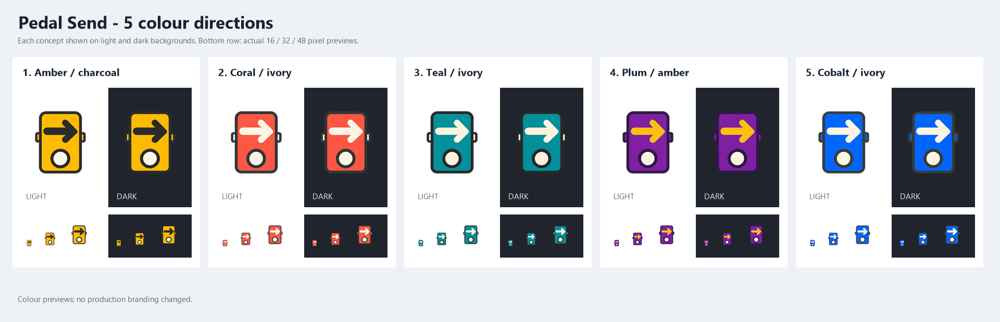

# Pedal Send colour exploration

The user preferred the pedal direction and requested more character than dark blue over medium blue. Five colour edits were generated with the built-in image_gen tool on 14 October 2026, using the existing pedal PNG as the edit target.

## Existing project palettes inspected

- Preset Maestro (the sibling Maestro project present in this workspace): its current preset_maestro.ico uses a red-to-orange/gold guitar pick, a charcoal dial, and white details. MainWindow.ApprovedLayout.cs defines blue interface accents (#1969B0 light / #2F80ED dark), light neutral surfaces, and dark charcoal surfaces (#11151B / #181D24). Its branding and interface do not need identical dominant colours.
- MIDI Forwarder: the earlier ICO retained under Branding/Previous is a pale blue/white interlocking loop mark. Its current transferred DIN Send branding is cobalt blue, navy, and white. The interface uses the existing Avalonia FluentTheme, with a custom dark log background RGB(35,42,52); no custom global accent palette was found in the inspected Client/Server App and window source.

Reference PNGs were exported from the existing ICO files without artistic modification. No sibling project files were changed for this colour study.

## Directions

| Option | File | Intent |
| --- | --- | --- |
| 1 | [Amber / charcoal](pedal-1-amber-charcoal.png) | Warm amber face, charcoal arrow and outline, warm ivory centre of footswitch. Avoid red so it is distinct from Maestro's red/orange pick. |
| 2 | [Coral / ivory](pedal-2-coral-ivory.png) | Rich warm coral-red face, warm ivory arrow, graphite outline and footswitch ring, warm ivory footswitch centre. |
| 3 | [Teal / ivory](pedal-3-teal-ivory.png) | Deep vivid teal face, warm ivory arrow, charcoal outline and footswitch ring, warm ivory footswitch centre. |
| 4 | [Plum / amber](pedal-4-plum-amber.png) | Rich plum-purple face, light golden amber arrow, charcoal-purple outline and footswitch ring, warm ivory footswitch centre. |
| 5 | [Cobalt / ivory](pedal-5-cobalt-ivory.png) | Cobalt face, warm ivory arrow, neutral graphite outline and footswitch ring, warm ivory footswitch centre. Do not use a dark blue arrow or dark blue outline. |

Amber/charcoal is the recommended warm direction: lively, strong arrow separation, and a physical-pedal feel. Teal/ivory is the strongest alternative for a distinct identity alongside Maestro's warm icon and MIDI Forwarder's blue. Plum/amber is the most expressive contrast. Cobalt/ivory demonstrates that lighter arrow detail improves even the existing blue direction.

The prompt asks for colour-only edits and preservation of all pedal shapes. Visual inspection confirms the original silhouette, arrow, side tabs, and circular footswitch remain recognisable across the five outputs. All were inspected on light and dark backgrounds at large size and 16/32/48 pixels. The dark casing merges partly into the dark preview surface, but the coloured body, arrow and light switch remain visible. Final pixel-size refinement still follows selection.

Generated colours are visually illustrative and do not exactly reproduce the requested hex values; the outputs also retain some subtle tonal variation. The manifest contains the intended prompt palette, not measurements of exact exported colours. No claim of colourimetric or final accessibility compliance is made.

## Design guidance

The previously consulted [Microsoft app icon guidance](https://learn.microsoft.com/en-us/windows/apps/design/iconography/app-icon-design) supports clear shape/metaphor and contrast checks across light/dark backgrounds. [Fluent 2 iconography](https://fluent2.microsoft.design/iconography) informs recognisable symbols and detail reduction at small sizes. The warm/teal/plum palettes are product choices. This is a branding preview; no app layout, theme, interaction, or production icon has changed.

Exact prompts are in [prompts.md](prompts.md). Individual transparent outputs are preserved unmodified; Build-Comparison.ps1 only scales and lays out previews.
