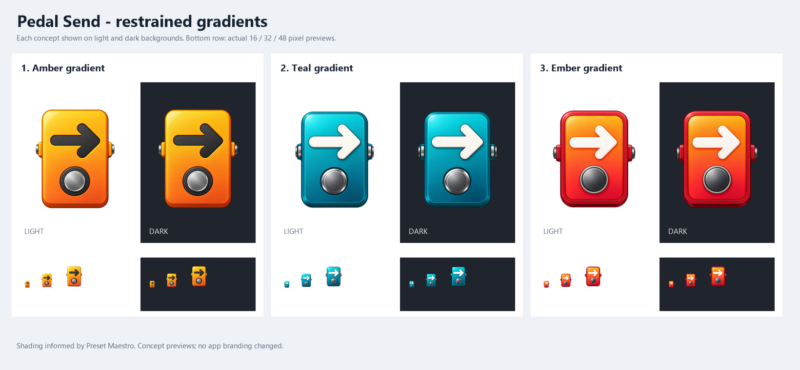

# Pedal Send: restrained gradients

The user requested more life than flat colour, then asked to bring the degree of shading closer to Preset Maestro's existing gradient icon. These three revisions were generated with the built-in image_gen tool on 14 October 2026.

**Selected: Amber Gradient (option 1).** The export script uses its original transparent PNG for the app/header/window icon, Windows executable icon, and website-ready logo/favicons. The source artwork is preserved, with size/format conversion only.

1. [Amber gradient](pedal-1-amber-gradient.png): amber-to-orange face, dark recessed arrow, softly shaded circular switch.
2. [Teal gradient](pedal-2-teal-gradient.png): turquoise-to-petrol face, light arrow, softly shaded grey switch.
3. [Ember gradient](pedal-3-ember-gradient.png): golden-orange-to-coral-red face, light arrow, charcoal switch. This is closest to the Maestro colour/gradient family; teal gives the preset utility a more separate identity.

Preserved cues: rounded effects pedal, two side connectors, prominent right-facing forwarding arrow and one circular footswitch. Reduced photographic reflections, metal texture and glowing edges relative to the initial PedalDepth studies. Broad smooth shading and restrained bevels follow the existing Maestro reference; the switch has no dial needle or tick marks. All original concept PNGs remain unmodified; production exports now use Amber Gradient.

## Verification and design decisions

Visually inspected the large originals and comparison sheet on light/dark backgrounds and at actual 16, 32 and 48 pixel sizes. The arrow and switch remain the primary readable forms; small-size refinement remains necessary before final icon export. These previews are not an application layout change and do not claim finished pixel-grid alignment or exact colour/contrast compliance.

The previously consulted [Microsoft app-icon guidance](https://learn.microsoft.com/en-us/windows/apps/design/iconography/app-icon-design) favours clear simple metaphors, controlled colour treatment and small-size legibility; [Fluent 2 iconography](https://fluent2.microsoft.design/iconography) recommends simpler detail at small sizes. Smooth gradients, modest edge depth and the softly shaded switch are the user's requested style adaptation. Strong product-photo reflections and illumination from the previous study were reduced.

Full prompts and edit-reference roles are recorded in [prompts.md](prompts.md), with source outputs in manifest.json. The three delivered PNGs are copied directly from the built-in output. Build-Comparison.ps1 only composes scaled previews while retaining square source proportions.
