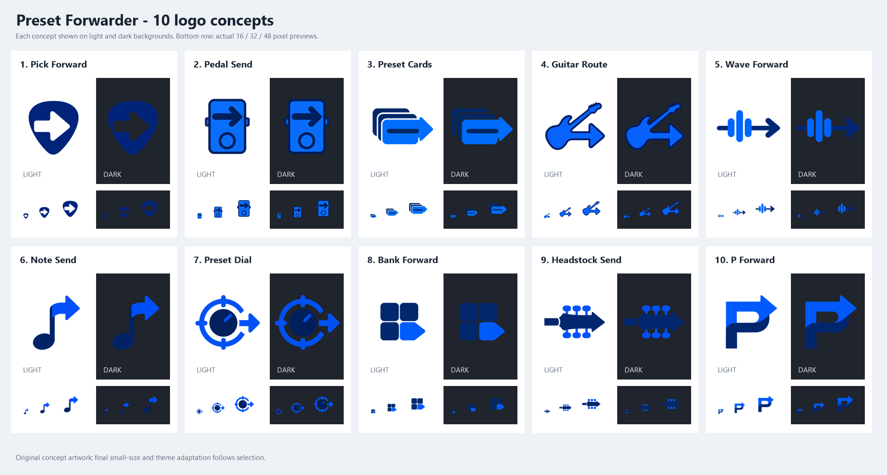

# Preset Forwarder: ten new logo concepts

Created on 14 October 2026 using the built-in image_gen tool. These are original transparent PNG concept marks, saved individually in this directory. The application remains named Preset Sender; no application rename is included.

The user preferred the pedal direction and requested a stronger colour palette. [Five Pedal Send colour studies](PedalColours/README.md) compare amber, coral, teal, plum and cobalt with contrasting arrow/switch colours, informed by the existing Maestro and MIDI Forwarder branding. The user subsequently selected **Amber Gradient** for the production logo and icon.

After finding the flat studies lifeless, the user requested depth and then shading closer to Preset Maestro's gradients. [Three restrained gradient revisions](PedalGradients/README.md) are the latest concepts; the stronger [initial material studies](PedalDepth/README.md) are retained as references.

| Option | Name | Meaning |
| --- | --- | --- |
| 1 | [Pick Forward](option-01-pick-forward.png) | Guitar pick with a send arrow cut through its centre. |
| 2 | [Pedal Send](option-02-pedal-send.png) | Effects pedal with a send arrow: guitar sounds and switching. |
| 3 | [Preset Cards](option-03-preset-cards.png) | Stored preset cards becoming an outgoing arrow. |
| 4 | [Guitar Route](option-04-guitar-route.png) | Electric guitar body flowing into a forwarding arrow. |
| 5 | [Wave Forward](option-05-wave-forward.png) | Musical signal bars on an outgoing route. |
| 6 | [Note Send](option-06-note-send.png) | Musical note whose flag becomes a send arrow. |
| 7 | [Preset Dial](option-07-preset-dial.png) | Preset selector dial with an outgoing arrow. |
| 8 | [Bank Forward](option-08-bank-forward.png) | Preset bank with one selected tile forwarded outward. |
| 9 | [Headstock Send](option-09-headstock-send.png) | Guitar headstock shaped into a send arrow. |
| 10 | [P Forward](option-10-p-forward.png) | P for preset, merged with a forwarding arrow. |

## Recommendation and limitations

Option 2, Pedal Send, is the strongest initial combination of guitar relevance, preset-switching association, and light/dark visibility. Option 1, Pick Forward, is the simplest guitar identity and would benefit from a brighter cobalt body or a contrasting edge for dark backgrounds. Option 3, Preset Cards, communicates stored presets without tying the utility to a particular instrument.

All ten have been visually inspected in the comparison sheet on light and dark backgrounds and at 16, 32, and 48 pixels. These are concept previews, not final production icons. The navy portions lose contrast on dark backgrounds, particularly options 1, 5, 8 and 9. Options 4 and 9 lose guitar detail at 16 pixels. The selected design needs deliberate small-size and theme adaptation before replacing the application icon. Some generated marks contain subtle tonal variation despite the flat-colour prompt.

The user selected **Amber Gradient** from the pedal refinements; it is now used for the Preset Sender app, executable and website-ready exports. The original DIN Send production mark has been copied into the sibling MIDI-Forwarder repository for its Windows/tray icon, macOS bundle icon, and website-ready logo exports. Its source remains preserved in the earlier Options directory.

## Design sources and choices

- [Microsoft Windows app icon design](https://learn.microsoft.com/en-us/windows/apps/design/iconography/app-icon-design): use simple forms, a clear focal metaphor, few details, and a distinctive silhouette that scales. Its guidance also recommends checking contrast on light and dark backgrounds and avoiding letters unless essential.
- [Microsoft Fluent 2 iconography](https://fluent2.microsoft.design/iconography): prioritise recognisable, functional icons and simplify detail below 48 pixels.

The guitar/preset/music cue plus one forwarding arrow, the existing cobalt/navy palette, and transparent backgrounds are product choices. Option 10 deliberately explores a letter-based identity despite Microsoft's preference to avoid typography. No claim of production pixel-grid alignment or finished contrast compliance is made for these concept images.

Full generation prompts are in [prompts.md](prompts.md); the manifest records source output paths and local filenames. Artwork was generated with the built-in tool, then copied without modification. Build-Comparison.ps1 only lays out and scales the existing images for visual comparison.
